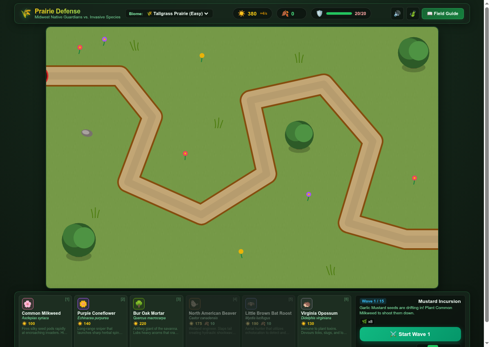

> [!NOTE]
> This repository was created as an example of agentic coding for IWU's "AI For All" class in November, 2026.

# 🌾 Prairie Defense: Midwest Native Guardians

> **A browser-based tower defense game celebrating Midwestern ecology — native plants and animals vs. invasive species.**

[](https://liffiton.github.io/Prairie-Defense/)

### 🎮 **[Play the Live Game Here](https://liffiton.github.io/Prairie-Defense/)**

---



---

## 🤖 Vibe Coded with Antigravity

This entire game — including the TypeScript architecture, 60fps HTML5 Canvas rendering pipeline, interactive UI, custom procedural Web Audio synthesis engine, game balance, and the educational Midwestern species bestiary — was vibe-coded from a single prompt in November, 2026 using Google's Antigravity (powered by Gemini Flash 3.8).

To see the complete prompt history and some step-by-step implementation evidence (Antigravity doesn't easily export with much detail), check out:

📄 **[Read the Full Agent Conversation Transcript](AGENT_CONVERSATION.md)**

---

## 🌻 Game Concept & Midwestern Ecology

In the heart of the Midwest, native tallgrass prairies, oak savannas, and Great Lakes coastal marshes are under siege from destructive invasive pests. As the Habitat Restoration Warden, you cultivate and position native plants and wildlife guardians to stop invaders from reaching the pristine Core Sanctuary!

### 🌿 Native Guardians (Towers)
* **🌸 Common Milkweed (*Asclepias syriaca*)**: Rapid seed darts. Upgrades add toxic cardenolides; Tier 3 unlocks **Monarch Haven**, summoning an orbiting Monarch Butterfly that boosts adjacent native plants' attack speed by +25%!
* **🌼 Purple Coneflower (*Echinacea purpurea*)**: Piercing herbal sniper with deep taproots that shoots through entire columns of pests and coats them in slowing nectar.
* **🌳 Bur Oak Mortar (*Quercus macrocarpa*)**: Savanna keystone giant. Lobs heavy acorns that crash with massive AoE shockwaves to crush armored pests.
* **🦫 North American Beaver (*Castor canadensis*)**: Amphibious wetland engineer. Slaps tail creating hydraulic shockwaves that knock back creeps; can be planted on land or directly inside water channels.
* **🦇 Little Brown Bat Roost (*Myotis lucifugus*)**: High-frequency echolocation aerial hunter dealing +100% bonus damage to airborne pests.
* **🦔 Virginia Opossum (*Didelphis virginiana*)**: Poison-immune scavenger that devours low-HP pests and generates bonus **Biomass 🍂** compost!

### ⚠️ Invasive Threats (Invaders)
* **🌿 Garlic Mustard**: Releases allelopathic root toxins that suppress the firing rate of nearby native plants.
* **🪲 Emerald Ash Borer**: Airborne wood-borer with 50% evasion against ground attacks.
* **🪰 Spotted Lanternfly**: Acrobatic sap-sucker that makes sudden forward speed leaps.
* **🐚 Zebra Mussel Colony**: Heavily armored mollusk cluster; shrugs off seed darts but weak to Bur Oak acorns.
* **🌾 Japanese Knotweed**: Tough creeping rhizome that splits into aggressive sprouts upon defeat.
* **🐟 Asian Silver Carp**: Rapid aquatic swimmer that leaps along waterways.
* **🐗 Feral Hog [Boss]**: High-health bruiser immune to regular slows.
* **🌲 Buckthorn Titan [Final Boss]**: Colossal suffocating thicket that continuously regenerates health and shields followers.

---

## 🗺️ Playable Biomes

1. **🌾 Tallgrass Prairie Sanctuary** (Easy): A winding single trail through big bluestem and coneflowers.
2. **🌳 Oak Savanna & Glade** (Medium): Converging dual-ridge trails navigating around ancient bur oaks.
3. **🌊 Great Lakes Coastal Wetland** (Hard): A sedge shoreline boardwalk alongside a deep aquatic channel where carp and zebra mussels travel fast.

---

## ⌨️ Controls & Hotkeys

| Action | Control |
| :--- | :--- |
| **Select Guardian** | `[1]` to `[6]` or click shop drawer card |
| **Plant / Select** | `Left-Click` on canvas |
| **Cancel / Deselect** | `Right-Click` or `[Esc]` |
| **Upgrade Guardian** | `[U]` (or inspector button) |
| **Compost Guardian** | `[S]` (70% resource refund) |
| **Start Wave / Pause**| `[Space]` |
| **Game Speed** | `⏸` Pause, `1x`, `2x`, `4x` buttons |
| **Auto Wave** | Toggle `Auto Next` checkbox |
| **📖 Field Guide** | Click top-right button for in-depth species facts & real-world conservation tips |

---

## 🛠️ Local Development

To run the game locally:

```bash
# Clone the repository
git clone https://github.com/liffiton/Prairie-Defense.git
cd Prairie-Defense

# Install dependencies
npm install

# Start local dev server
npm run dev
```

Open `http://localhost:5173/` in your browser.

To create a production build or standalone zip:
```bash
npm run build   # Outputs to dist/
npm run bundle  # Outputs prairie-defense.zip
```
